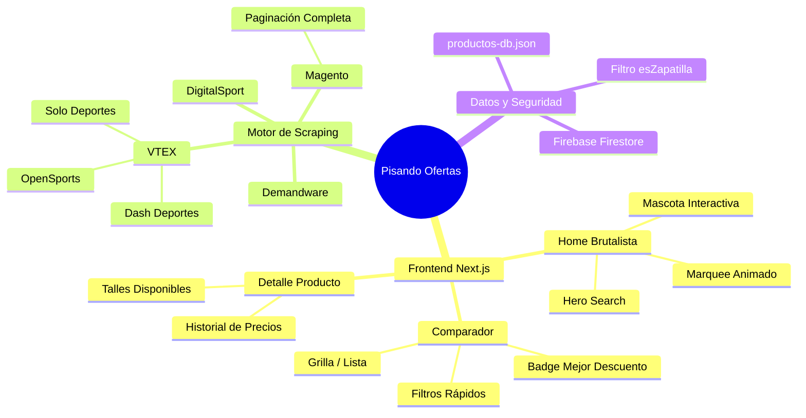
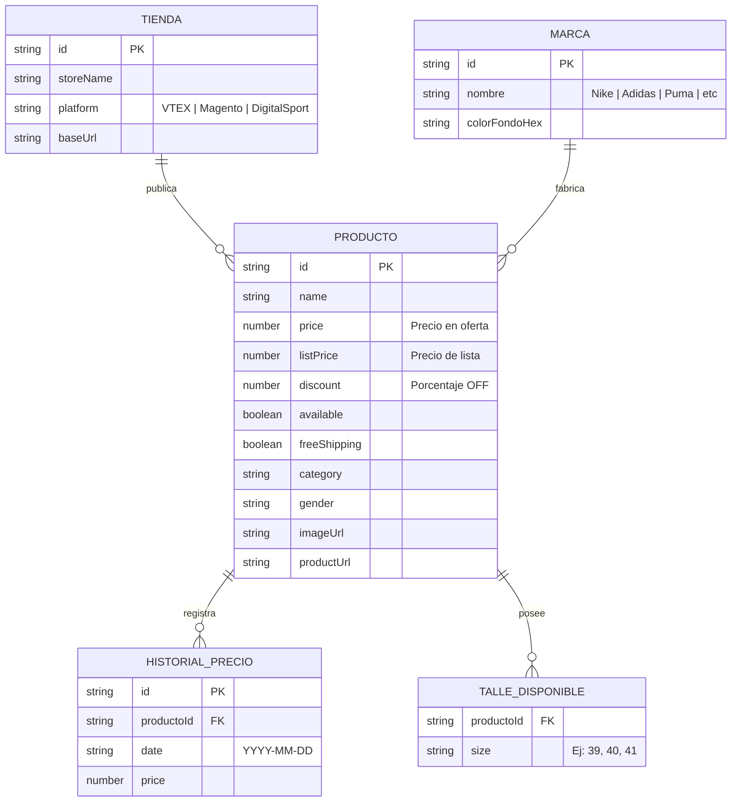
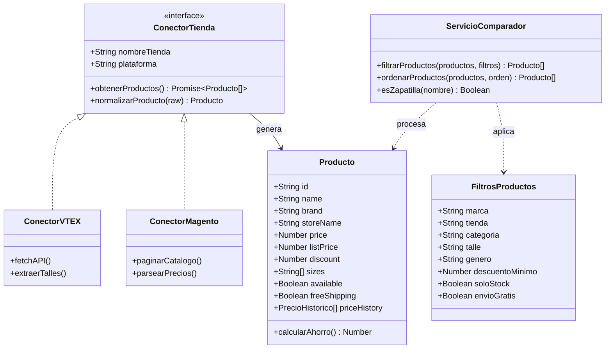
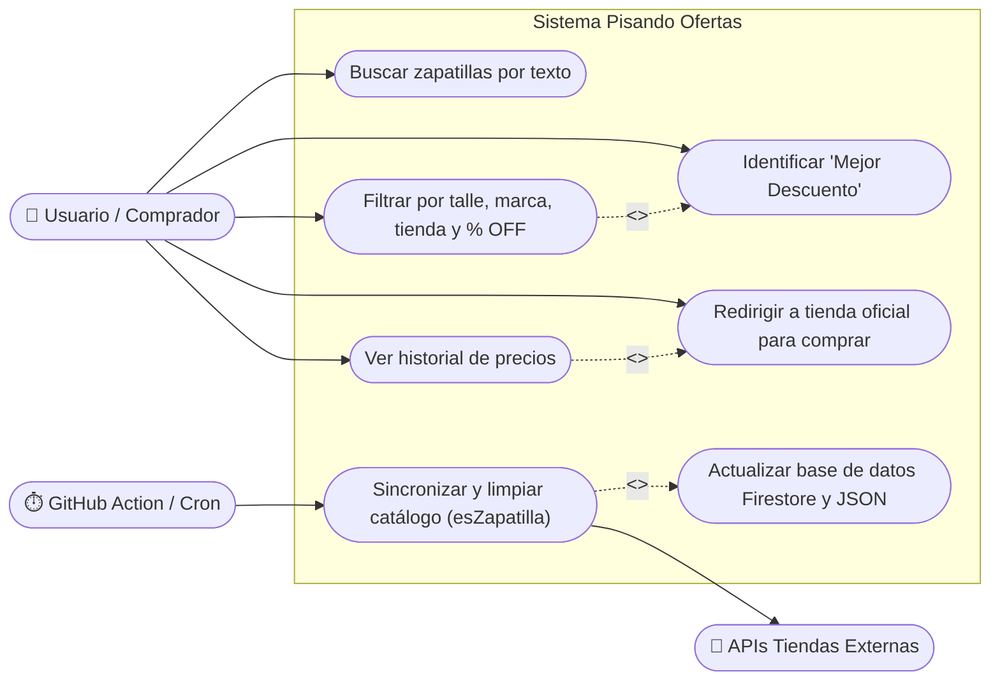

# 👟 Documentación y Arquitectura Completa: Pisando Ofertas

Esta nota contiene **todos los tipos de diagramas** conviviendo en el mismo documento de Obsidian.
> 💡 **Tip:** También podés abrir el archivo **`Tablero-Arquitectura.canvas`** que está en esta misma carpeta para ver todos estos diagramas distribuidos en una **pizarra infinita estilo Miro**.

---

## 1. 🧠 Mapa Mental del Ecosistema (Mindmap)

---

## 2. 🗄️ Diagrama Entidad-Relación (DER)

---

## 3. 🏛️ Diagrama de Clases (Dominio y Conectores)

---

## 4. 👤 Diagrama de Casos de Uso (UML)

