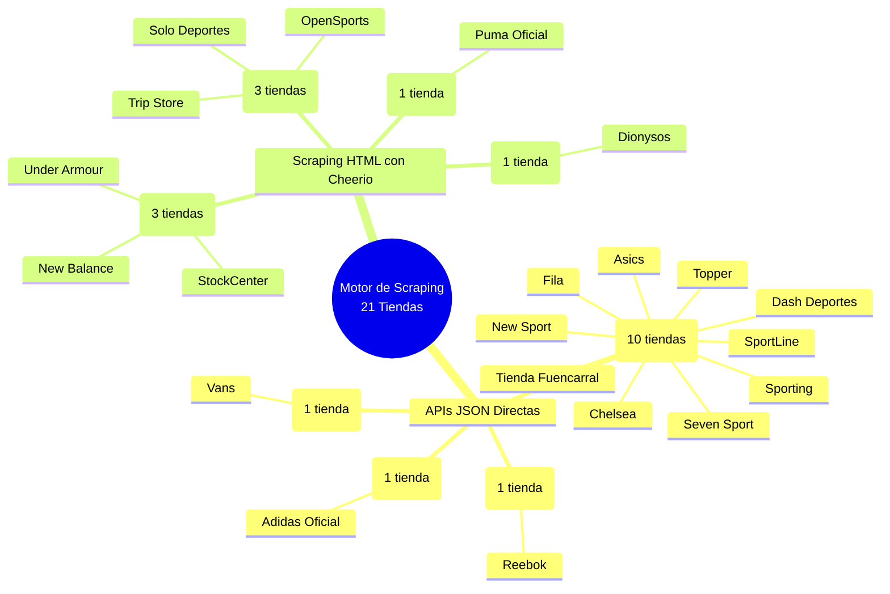
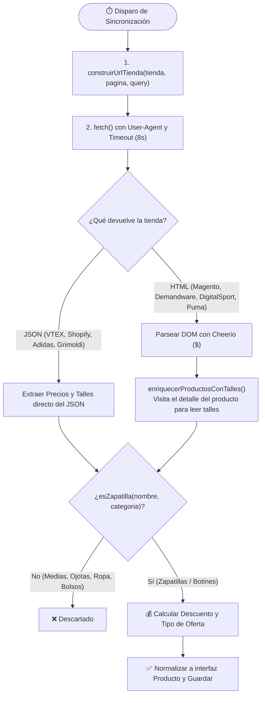

# 🕵️‍♂️ Cómo Conseguimos los Datos y Descuentos por cada Tienda

Este documento detalla la ingeniería detrás de **`src/lib/connectors/tiendas-externas.ts`** y **`src/lib/connectors/talles-detalle.ts`**: cómo consultamos cada una de las **21 tiendas**, qué formato devuelven (JSON vs. HTML), cómo extraemos el **precio en oferta**, el **precio de lista tachado**, el **% de descuento**, los **talles con stock** y cómo filtramos intrusos con `esZapatilla()`.

---

## 🗺️ 1. Mapa Mental: Las 8 Plataformas de Scraping

---

## 🔄 2. Flujo General de Extracción y Cálculo de Descuentos

---

## 🏪 3. Detalle Técnico por Plataforma y Página

### A. Plataforma **VTEX** (10 tiendas)
* **Tiendas:** Tienda Fuencarral, Asics, Fila, Topper, New Sport, Chelsea, Seven Sport, SportLine, Sporting, Dash Deportes.
* **Método:** API REST Pública de Catálogo VTEX (JSON directo, no requiere HTML scraping).
* **Endpoint:**
  `GET {baseUrl}/api/catalog_system/pub/products/search?ft=zapatillas&_from=0&_to=49&O=OrderByBestDiscountDESC`
* **Cómo sacamos los precios y descuentos:**
  * **Precio Oferta (`price`):** `sku.sellers[0].commertialOffer.Price`
  * **Precio Lista (`listPrice`):** `sku.sellers[0].commertialOffer.ListPrice`
  * **Descuento (`discount`):** `Math.round(((listPrice - price) / listPrice) * 100)`
  * **Talles (`sizes`):** Recorre todos los `items[]` con stock y junta los valores del campo `item.Talle`.

---

### B. Plataforma **Demandware / Salesforce Commerce Cloud** (3 tiendas)
* **Tiendas:** StockCenter, Under Armour, New Balance.
* **Método:** Endpoint AJAX de grilla HTML (`Cheerio`).
* **Endpoint:**
  `GET {baseUrl}/on/demandware.store/{siteId}/default/Search-UpdateGrid?q=zapatillas&srule=product-discount&start=0&sz=36`
* **Cómo sacamos los precios y descuentos:**
  * **Precio Oferta (`price`):** `.sales .value[content]` o `gtm.price`.
  * **Precio Lista (`listPrice`):** `.strike-through .value[content]` (el precio tachado).
  * **Descuento (`discount`):** Lee el badge `.discount-percentage` o lo calcula con `((listPrice - price) / listPrice) * 100`.
  * **Talles (`sizes`):** `enriquecerProductosConTalles()` entra al HTML del producto y extrae los `.variation-attribute-size` habilitados.

---

### C. Plataforma **Magento 2** (3 tiendas)
* **Tiendas:** Solo Deportes (`/ofertas/calzado.html`), OpenSports (`/ofertas.html`), Trip Store (`/ofertas.html`).
* **Método:** Scraping HTML con `Cheerio` paginando con `?p=1, 2, 3...`.
* **Cómo sacamos los precios y descuentos:**
  * **Precio Oferta (`price`):** `[data-price-type="finalPrice"] -> data-price-amount` o `.special-price .price`.
  * **Precio Lista (`listPrice`):** `[data-price-type="oldPrice"] -> data-price-amount` o `.old-price .price`.
  * **Talles (`sizes`):** Extrae del JSON de opciones de Magento (`talle_calzado`) en el detalle del producto.

---

### D. Plataforma **DigitalSport** (1 tienda)
* **Tienda:** Dionysos (`digitalsport.com.ar/dionysos/search/?q=zapatillas`).
* **Cómo sacamos los precios y descuentos:**
  * **Precio Oferta (`price`):** Atributo HTML `data-price` en `a.product[productid]`.
  * **Precio Lista (`listPrice`):** Regex sobre el texto buscando `antes $ 123.456`.
  * **Talles (`sizes`):** Lee `#sizes label.sizeLbl:not(.nostock)`.

---

### E. Plataforma **Shopify** (1 tienda)
* **Tienda:** Reebok (`reebok.com.ar/collections/calzado/products.json?limit=250&page=1`).
* **Cómo sacamos los precios y descuentos:**
  * **Precio Oferta (`price`):** `variant.price`
  * **Precio Lista (`listPrice`):** `variant.compare_at_price`
  * **Talles (`sizes`):** Extraído del título de cada variante con `available: true`.

---

### F. Plataforma **Grimoldi** (1 tienda)
* **Tienda:** Vans (`vans.com.ar/Product/Results?query=zapatillas&take=50&skip=0` con header `X-Requested-With: XMLHttpRequest`).
* **Cómo sacamos los precios y descuentos:**
  * **Precio Oferta (`price`):** `articulo.precioActual`
  * **Precio Lista (`listPrice`):** `articulo.precioAnterior`
  * **Descuento (`discount`):** `articulo.porcentajeDescuento`

---

### G. Plataforma **Adidas Oficial** (1 tienda)
* **Tienda:** Adidas (`adidas.com.ar/api/search/taxonomy?sitePath=ar&query=zapatillas&start=0`).
* **Cómo sacamos los precios y descuentos:**
  * **Precio Oferta (`price`):** `item.salePrice`
  * **Precio Lista (`listPrice`):** `item.price`
  * **Descuento (`discount`):** `item.salePercentage`
  * **Talles (`sizes`):** `item.availableSizes[]`

---

### H. Plataforma **Puma Oficial** (1 tienda)
* **Tienda:** Puma (`ar.puma.com/calzado/zapatillas.html?offset=0`).
* **Cómo sacamos los precios y descuentos:**
  * Extrae los precios con signo `$` de cada `.product-tile`: el primero es el `listPrice` (tachado) y el último es el `price` (rebajado).
