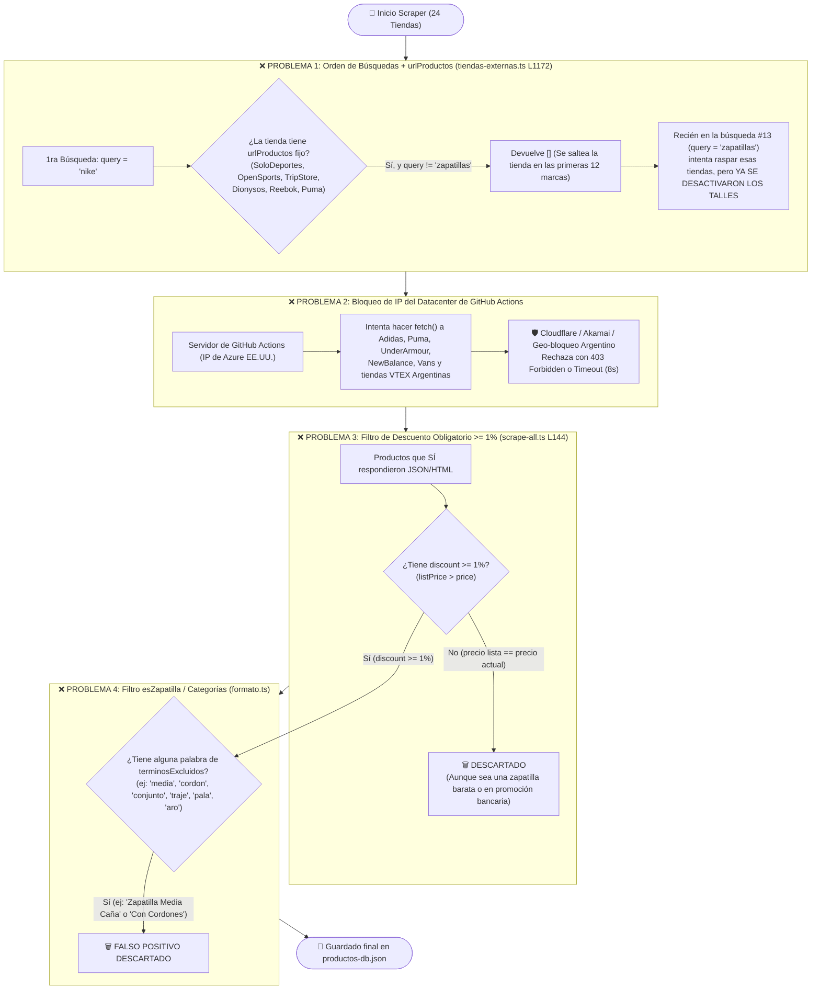

# 🚨 Diagnóstico Real: ¿Por qué hay tiendas y productos que NO se reciben?

Hice una auditoría sobre el código real (`src/scripts/scrape-all.ts` y `src/lib/connectors/tiendas-externas.ts`) y sobre lo que **hoy mismo tiene guardado `src/data/productos-db.json`**.

El hallazgo es contundente: **tenemos 24 tiendas configuradas en el código, pero en `productos-db.json` SOLO hay productos de 6 tiendas (7.227 zapatillas en total), y las otras 18 tiendas tienen 0 productos.** Además, Solo Deportes y OpenSports tienen **0 talles** cargados.

---

## 📊 1. Estado Actual de `productos-db.json` (La Evidencia)

| Tienda | Plataforma | Productos en DB hoy | Con Talles cargados | Estado Real |
| :--- | :--- | :---: | :---: | :--- |
| **Solo Deportes** | Magento | 2.591 | **0 (0%)** | ⚠️ Entra sin talles |
| **StockCenter** | Demandware | 2.033 | 1.715 (84%) | ✅ OK |
| **Dexter** | Demandware | 1.002 | 744 (74%) | ✅ OK |
| **Moov** | Demandware | 791 | 765 (96%) | ✅ OK |
| **OpenSports** | Magento | 702 | **0 (0%)** | ⚠️ Entra sin talles |
| **Grid** | VTEX | 108 | 108 (100%) | ⚠️ Pocos (solo los de descuento) |
| **Las otras 18 tiendas** | Todas | **0** | **0** | ❌ **NO SE ESTÁN RECIBIENDO** |

---

## 🛑 2. Diagrama del Embudo: ¿Dónde mueren los productos?

