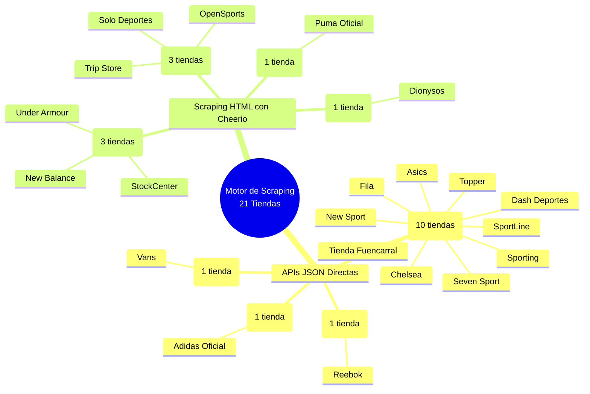
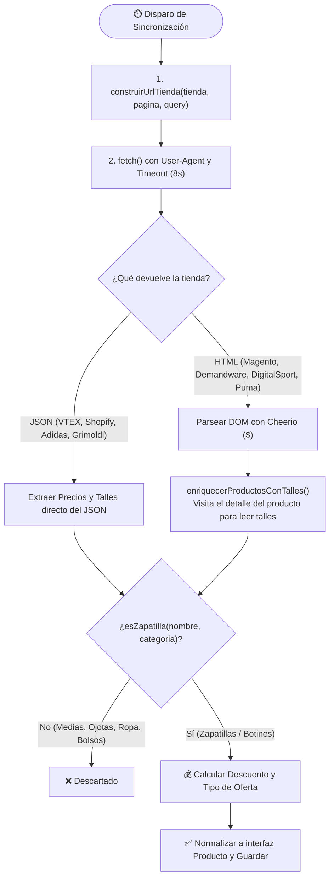

# 🕵️‍♂️ Cómo Conseguimos los Datos y Descuentos por cada Tienda

Este documento detalla la ingeniería detrás de **`src/lib/connectors/tiendas-externas.ts`** y **`src/lib/connectors/talles-detalle.ts`**: cómo consultamos cada una de las **21 tiendas**, qué formato devuelven (JSON vs. HTML), cómo extraemos el **precio en oferta**, el **precio de lista tachado**, el **% de descuento**, los **talles con stock** y cómo filtramos intrusos con `esZapatilla()`.

---

## 🗺️ 1. Mapa Mental: Las 8 Plataformas de Scraping

---

## 🔄 2. Flujo General de Extracción y Cálculo de Descuentos

---

## 🏪 3. Detalle Técnico por Plataforma y Página

### A. Plataforma **VTEX** (10 tiendas)
* **Tiendas:** Tienda Fuencarral, Asics, Fila, Topper, New Sport, Chelsea, Seven Sport, SportLine, Sporting, Dash Deportes.
* **Método:** API REST Pública de Catálogo VTEX (JSON directo, no requiere HTML scraping).
* **Endpoint:**
  `GET {baseUrl}/api/catalog_system/pub/products/search?ft=zapatillas&_from=0&_to=49&O=OrderByBestDiscountDESC`
  *(Nota: Se les pide ordenado directamente por mayor descuento `OrderByBestDiscountDESC`, de a 50 productos por página).*
* **Cómo sacamos los precios y descuentos:**
  * Dentro de cada producto vienen sus SKUs (`items[]`). La función `elegirSkuVtex()` busca el SKU que tenga stock (`IsAvailable` o `AvailableQuantity > 0`) y mayor descuento.
  * **Precio Oferta (`price`):** `sku.sellers[0].commertialOffer.Price`
  * **Precio Lista (`listPrice`):** `sku.sellers[0].commertialOffer.ListPrice`
  * **Descuento (`discount`):** `Math.round(((listPrice - price) / listPrice) * 100)`
  * **Talles (`sizes`):** Recorre todos los `items[]` con stock y junta los valores del campo `item.Talle`.

---

### B. Plataforma **Demandware / Salesforce Commerce Cloud** (3 tiendas)
* **Tiendas:** StockCenter, Under Armour, New Balance.
* **Método:** Endpoint AJAX de grilla HTML (`Cheerio`).
* **Endpoint:**
  `GET {baseUrl}/on/demandware.store/{siteId}/default/Search-UpdateGrid?q=zapatillas&srule=product-discount&start=0&sz=36`
  *(En StockCenter además se filtra con `cgid=sale` para traer directo la sección de ofertas).*
* **Cómo sacamos los precios y descuentos:**
  * Busca cada tarjeta `.product[data-pid]` y también lee el JSON oculto de Google Tag Manager en `input.productGtmData`.
  * **Precio Oferta (`price`):** `.sales .value[content]` o texto de `.sales` o `gtm.price`.
  * **Precio Lista (`listPrice`):** `.strike-through .value[content]` (el precio tachado).
  * **Descuento (`discount`):** Lee el badge `.discount-percentage` o lo calcula con `((listPrice - price) / listPrice) * 100`.
  * **Talles (`sizes`):** Como la grilla no muestra todos los talles, `enriquecerProductosConTalles()` entra al HTML del producto y extrae los `.variation-attribute-size` que **no** tengan la clase `.disabled`.

---

### C. Plataforma **Magento 2** (3 tiendas)
* **Tiendas:** Solo Deportes (`/ofertas/calzado.html`), OpenSports (`/ofertas.html`), Trip Store (`/ofertas.html`).
* **Método:** Scraping HTML con `Cheerio` paginando con `?p=1, 2, 3...` (Solo Deportes recorre hasta 220 páginas de ofertas).
* **Cómo sacamos los precios y descuentos:**
  * Selecciona cada `li.product-item`.
  * **Precio Oferta (`price`):** Atributo numérico `[data-price-type="finalPrice"] -> data-price-amount` o el texto de `.special-price .price`.
  * **Precio Lista (`listPrice`):** Atributo `[data-price-type="oldPrice"] -> data-price-amount` o el texto de `.old-price .price`.
  * **Descuento (`discount`):** Calculado matemáticamente entre `oldPrice` y `finalPrice`.
  * **Talles (`sizes`):** En la página de detalle, busca con una expresión regular el JSON de configuración de Magento (`"code":"talle_calzado" ... "options":[...]`) y extrae cada `label` que tenga productos asociados.

---

### D. Plataforma **DigitalSport** (1 tienda)
* **Tienda:** Dionysos (`digitalsport.com.ar/dionysos/search/?q=zapatillas`).
* **Método:** Scraping HTML con `Cheerio`.
* **Cómo sacamos los precios y descuentos:**
  * Selecciona cada tarjeta `a.product[productid]`.
  * **Precio Oferta (`price`):** Viene limpio en el atributo HTML `data-price`.
  * **Precio Lista (`listPrice`):** Busca en el texto de la tarjeta con Regex el patrón `antes $ 123.456` (`/antes\s*\$?\s*([\d.,]+)/i`).
  * **Descuento (`discount`):** Busca el patrón `-30%` en la tarjeta o lo calcula entre ambos precios.
  * **Envío Gratis:** Detecta si el texto de la tarjeta dice `"envio gratis"`.
  * **Talles (`sizes`):** En el detalle del producto lee `#sizes label.sizeLbl` que **no** tengan la clase `.nostock`.

---

### E. Plataforma **Shopify** (1 tienda)
* **Tienda:** Reebok (`reebok.com.ar/collections/calzado/products.json?limit=250&page=1`).
* **Método:** API JSON nativa de colecciones de Shopify.
* **Cómo sacamos los precios y descuentos:**
  * Filtra las variantes con `variant.available === true`.
  * **Precio Oferta (`price`):** `mainVariant.price`
  * **Precio Lista (`listPrice`):** `mainVariant.compare_at_price`
  * **Descuento (`discount`):** Calculado entre `compare_at_price` y `price`.
  * **Talles (`sizes`):** Extrae el talle del `title` de cada variante disponible (ej: `"Blanco / 41"` -> `"41"`).

---

### F. Plataforma **Grimoldi** (1 tienda)
* **Tienda:** Vans (`vans.com.ar/Product/Results?query=zapatillas&take=50&skip=0`).
* **Método:** Petición AJAX con header `X-Requested-With: XMLHttpRequest` que obliga al servidor de Vans/Grimoldi a responder un JSON limpio (`{ articulos: [...] }`).
* **Cómo sacamos los precios y descuentos:**
  * **Precio Oferta (`price`):** `articulo.precioActual`
  * **Precio Lista (`listPrice`):** `articulo.precioAnterior`
  * **Descuento (`discount`):** `articulo.porcentajeDescuento` (o calculado).

---

### G. Plataforma **Adidas Oficial** (1 tienda)
* **Tienda:** Adidas (`adidas.com.ar/api/search/taxonomy?sitePath=ar&query=zapatillas&start=0`).
* **Método:** API interna de búsqueda de Adidas (JSON).
* **Cómo sacamos los precios y descuentos:**
  * **Precio Oferta (`price`):** `item.salePrice` (o `item.price` si no tiene rebaja).
  * **Precio Lista (`listPrice`):** `item.price`
  * **Descuento (`discount`):** `item.salePercentage`
  * **Talles (`sizes`):** Viene directo en el array `item.availableSizes`.

---

### H. Plataforma **Puma Oficial** (1 tienda)
* **Tienda:** Puma (`ar.puma.com/calzado/zapatillas.html?offset=0`).
* **Método:** Scraping HTML con `Cheerio`.
* **Cómo sacamos los precios y descuentos:**
  * Busca cada `a.product-tile`.
  * Extrae todos los valores con signo `$` dentro de la tarjeta (`/\$\s*[\d.,]+/g`).
  * **Precio Lista (`listPrice`):** El primer precio que aparece en la tarjeta (el más alto/tachado).
  * **Precio Oferta (`price`):** El último precio que aparece en la tarjeta (el precio final rebajado).

---

## 📊 4. Resumen Comparativo por Tienda

| Tienda | Plataforma | Formato | ¿Dónde está el Precio Oferta? | ¿Dónde está el Precio Lista? | ¿Talles en la misma consulta? |
| :--- | :--- | :--- | :--- | :--- | :--- |
| **Fuencarral, Asics, Fila, Topper, New Sport, Chelsea, Seven Sport, SportLine, Sporting, Dash** | `vtex` | JSON API | `commertialOffer.Price` | `commertialOffer.ListPrice` | ✅ Sí (`item.Talle`) |
| **StockCenter, Under Armour, New Balance** | `demandware` | HTML Grid | `.sales .value[content]` | `.strike-through .value[content]` | 🔄 En 2da consulta (detalle) |
| **Solo Deportes, OpenSports, Trip Store** | `magento` | HTML Page | `[data-price-type="finalPrice"]` | `[data-price-type="oldPrice"]` | 🔄 En 2da consulta (detalle) |
| **Dionysos** | `digitalsport` | HTML Page | `a.product[data-price]` | Regex `antes $...` | 🔄 En 2da consulta (detalle) |
| **Reebok** | `shopify` | JSON API | `variant.price` | `variant.compare_at_price` | ✅ Sí (`variants[]`) |
| **Vans** | `grimoldi` | JSON AJAX | `articulo.precioActual` | `articulo.precioAnterior` | ❌ No expone en listado |
| **Adidas** | `adidas` | JSON API | `item.salePrice` | `item.price` | ✅ Sí (`availableSizes[]`) |
| **Puma** | `puma` | HTML Page | Último `$` de la card | Primer `$` de la card | ❌ No expone en listado |

---

## 🏷️ 5. Clasificación Automática del Descuento (`inferirTipoOferta`)

Una vez obtenido el porcentaje `discount`, el sistema clasifica cada zapatilla en 3 niveles:
* 🔥 **`liquidacion`**: Cuando el descuento es **>= 50% OFF** (activa el badge naranja `#FF4500` de Super Ahorro en la tarjeta).
* 🏷️ **`outlet`**: Cuando el descuento está entre **30% y 49% OFF**.
* ✨ **`temporada`**: Cuando el descuento es **< 30% OFF**.
