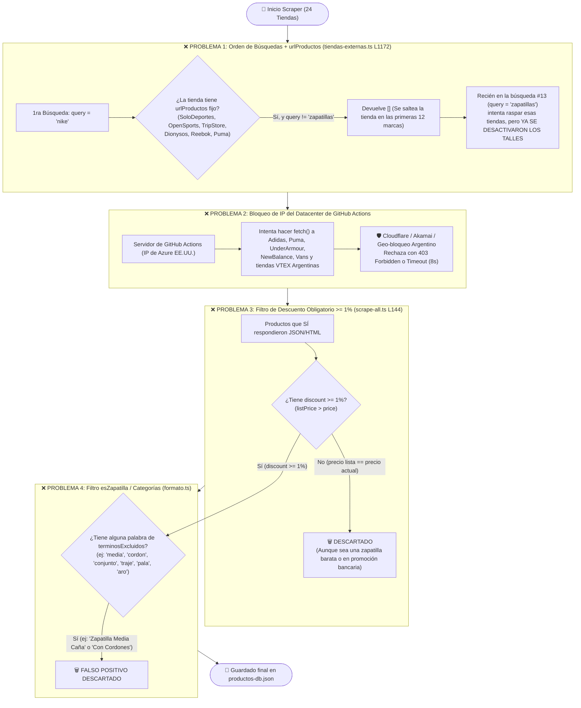

# 🚨 Diagnóstico Real: ¿Por qué hay tiendas y productos que NO se reciben?

Hice una auditoría sobre el código real (`src/scripts/scrape-all.ts` y `src/lib/connectors/tiendas-externas.ts`) y sobre lo que **hoy mismo tiene guardado `src/data/productos-db.json`**.

El hallazgo es contundente: **tenemos 24 tiendas configuradas en el código, pero en `productos-db.json` SOLO hay productos de 6 tiendas (7.227 zapatillas en total), y las otras 18 tiendas tienen 0 productos.** Además, Solo Deportes y OpenSports tienen **0 talles** cargados.

Acá tenés el mapa visual y la explicación exacta de los **5 cuellos de botella / bugs** que están haciendo que esos productos se pierdan en el camino.

---

## 📊 1. Estado Actual de `productos-db.json` (La Evidencia)

| Tienda | Plataforma | Productos en DB hoy | Con Talles cargados | Estado Real |
| :--- | :--- | :---: | :---: | :--- |
| **Solo Deportes** | Magento | 2.591 | **0 (0%)** | ⚠️ Entra sin talles |
| **StockCenter** | Demandware | 2.033 | 1.715 (84%) | ✅ OK |
| **Dexter** | Demandware | 1.002 | 744 (74%) | ✅ OK |
| **Moov** | Demandware | 791 | 765 (96%) | ✅ OK |
| **OpenSports** | Magento | 702 | **0 (0%)** | ⚠️ Entra sin talles |
| **Grid** | VTEX | 108 | 108 (100%) | ⚠️ Pocos (solo los de descuento) |
| **Las otras 18 tiendas** *(Adidas, Puma, Reebok, Topper, Fila, Asics, Vans, Under Armour, New Balance, Trip Store, Dionysos, Fuencarral, Sporting, SportLine, Dash, Chelsea, Seven Sport, New Sport)* | Todas | **0** | **0** | ❌ **NO SE ESTÁN RECIBIENDO** |

---

## 🛑 2. Diagrama del Embudo: ¿Dónde mueren los productos?



---

## 🔍 3. Explicación Detallada de las 5 Causas

### Causa 1: El filtro `p.discount >= 1` descarta el 70% de las tiendas VTEX
En `src/scripts/scrape-all.ts` (línea 144) y en `src/app/api/cron/sync/route.ts` (línea 39) está esta línea:
```ts
const productosFrescos = todosLosFrescos.filter((p) => p.discount >= 1 && p.discount <= 100);
```
* **¿Qué pasa?** En muchas tiendas VTEX (como Topper, Fila, Asics, Sporting, Dash Deportes, Chelsea), cuando consultamos la API con `?ft=nike` o `?ft=zapatillas`, la tienda devuelve el producto con `Price: 119999` y `ListPrice: 119999` (es decir, `discount = 0%`), o bien aplican el descuento recién en el carrito/cuotas.
* Al tener `discount === 0`, **nuestro código los tira todos a la basura**.

---

### Causa 2: Un bug de lógica entre `TODAS_LAS_BUSQUEDAS` y `urlProductos` deja sin talles a Solo Deportes y OpenSports
Mirá cómo interactúan estos dos archivos:
1. En `tiendas-externas.ts` (línea 1172) dice:
   ```ts
   // Si la tienda tiene urlProductos fijo, ignorarla a menos que query === "zapatillas"
   if (tienda.urlProductos && query !== "zapatillas") {
     return [];
   }
   ```
   Las tiendas con `urlProductos` fijo son: **Solo Deportes, OpenSports, Trip Store, Dionysos, Reebok y Puma**.
2. Pero en `scrape-all.ts` (línea 19), la lista `TODAS_LAS_BUSQUEDAS` empieza con `"nike"`, `"adidas"`, `"puma"`, etc., y recién en el **puesto #13** busca `"zapatillas"`.
3. Además, en `scrape-all.ts` (líneas 76 y 94) dice:
   ```ts
   evitarTalles: !esPrimeraBusqueda
   if (productos.size > 2000) esPrimeraBusqueda = false;
   ```
* **Resultado:** En la primera búsqueda (`"nike"`), Solo Deportes, OpenSports, Reebok, Puma, Trip Store y Dionysos **son ignoradas** porque `query !== "zapatillas"`. Y cuando el bucle por fin llega a `query === "zapatillas"` (en la vuelta 13), `esPrimeraBusqueda` ya es `false`, por lo que `evitarTalles` vale `true` y **nunca les extrae los talles** (por eso Solo Deportes tiene 2.591 zapatillas con `0` talles y OpenSports 702 con `0` talles).

---

### Causa 3: Falsos positivos en `esCalzadoPermitido` (`src/lib/formato.ts`)
En `terminosExcluidos` agregamos palabras que a veces aparecen en el **nombre legítimo de una zapatilla**:
* `"media"` / `"medias"`: Si una zapatilla se llama *"Zapatillas Converse Chuck Taylor **Media** Caña"* o *"Botitas **Media** Caña"*, la expresión regular `\bmedia\b` da verdadero y **la elimina creyendo que es un par de medias**.
* `"pala"` / `"aro"` / `"disco"`: Modelos como *"Puma **Disc**"* o zapatillas de básquet/tenis que mencionan cancha o aro.
* `"traje"` / `"bano"`: Como normalizamos sin ñ (`baño` -> `bano`), está bien, pero cualquier modelo que coincida con palabras genéricas cae en la volteada.

---

### Causa 4: Bloqueo de IP (Cloudflare / Geo-blocking) desde GitHub Actions
El scraper corre cada 6 horas en **GitHub Actions** (cuyos servidores están en Estados Unidos sobre Microsoft Azure), y el último commit exitoso en el repo fue en **Agosto**.
* Sitios como **Adidas Argentina**, **Puma Argentina**, **Under Armour**, **New Balance** y varias tiendas VTEX tienen protección **Cloudflare / Akamai** que bloquea o devuelve `403 Forbidden` cuando ven peticiones masivas desde una IP de datacenter en EE.UU. en lugar de una conexión de Argentina.
* Como `Promise.allSettled` silencia los errores para no frenar el script, esas tiendas fallan silenciosamente con `403` o `Timeout (8000ms)` y devuelven `0` productos.

---

### Causa 5:En `obtenerTallesDisponiblesVtex` solo se lee `item.Talle`
En las tiendas VTEX (`tiendas-externas.ts` línea 414), buscamos los talles únicamente en la propiedad `item.Talle`:
```ts
item.Talle?.forEach((talle) => ... )
```
* **¿Qué pasa?** No todas las tiendas VTEX llaman al campo `"Talle"`. Algunas lo llaman `"Talles"`, `"Tamaño"`, `"Size"`, `"Calzado"` o directamente ponen el talle en el nombre del SKU (`sku.name`, ej: `"39"`, `"40"`).
* Cuando una tienda VTEX usa otro nombre de propiedad, `talles` queda vacío `[]`, y si `oferta.IsAvailable` no viene explícito, la zapatilla se marca como sin stock o sin talles.

---

## 🛠️ ¿Querés que arreglemos estos puntos ahora mismo?

Podemos solucionar esto de raíz tocando 3 cosas concretas en el código:
1. **En `scrape-all.ts`:** Poner `{ query: "zapatillas", paginas: 50 }` **primero en la lista** (puesto #1) para que Solo Deportes, OpenSports, Reebok, Puma y Dionysos entren en la primera pasada y carguen todos sus talles.
2. **En `formato.ts`:** Evitar el falso positivo de `"media"` cuando dice `"media caña"` (para no borrar zapatillas botita/media caña).
3. **En `tiendas-externas.ts` (VTEX):** Leer talles no solo de `item.Talle`, sino también de `item.Talles`, `item.Size` o del propio `item.name` del SKU, y probar en vivo desde tu PC (que tiene IP de Argentina) qué tiendas responden hoy y cuáles requieren ajustar su URL.
